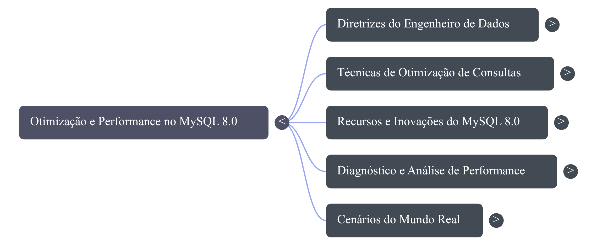

# Segundo Cérebro: Otimização de Consultas no MySQL 8.0

## 🎯 Tema e Objetivo
**Tema:** Otimização de consultas e performance analítica no MySQL 8.0.  
**Objetivo:** Dominar técnicas avançadas de otimização de queries, indexação e análise de plano de execução no MySQL 8.0 para reduzir o tempo de processamento de bases analíticas e relatórios de MIS.

---

## 📚 Fontes Selecionadas e Critérios de Confiança

A curadoria combinou a documentação oficial do banco de dados com análises práticas de referências globais em performance:

| Fonte | Formato | Link | Por que é confiável? |
| :--- | :--- | :--- | :--- |
| **MySQL 8.0 Reference Manual (Cap. 10 - Optimization)** | Documentação / PDF | [Acessar Fonte](https://dev.mysql.com/doc/refman/8.0/en/optimization.html) | Documentação oficial da Oracle, desenvolvedora e mantenedora do MySQL. Fonte primária sobre o funcionamento interno do otimizador e do motor InnoDB. |
| **MySQL 8.0 Reference Manual (Cap. 29 - Performance Schema)** | Documentação Web | [Acessar Fonte](https://dev.mysql.com/doc/refman/8.0/en/performance-schema.html) | Guia oficial da Oracle para monitoramento de execução de queries e inspeção de gargalos em nível de servidor. |
| **MySQL 8.0 Performance: Scalability & Benchmarks (Percona)** | Vídeo (YouTube) | [Acessar Vídeo](https://www.youtube.com/watch?v=MRKvGFlSk34) | A Percona é líder mundial em consultoria e desenvolvimento de soluções open-source para bancos relacionais. Apresenta benchmarks reais de arquitetura. |
| **Master MySQL 8 Query Optimization in 10 MINUTES! (ClayDesk)** | Vídeo (YouTube) | [Acessar Vídeo](https://www.youtube.com/watch?v=kVHwcyoEekQ) | Conteúdo técnico focado na aplicação direta de índices e refatoração rápida de consultas na versão 8.0. |

---

## 🤖 Diretriz de Comportamento do Notebook

Instrução configurada para direcionar o comportamento da IA:

> "Comporte-se como um Engenheiro de Dados sênior, especialista em performance e otimização no MySQL 8.0. Sua missão é me ajudar a refatorar e otimizar consultas SQL voltadas para análise de dados no setor de MIS (Planejamento Estratégico).
> 
> Siga estas regras estritamente:
> 1. **Baseie-se apenas nos dados das fontes:** Extraia as respostas exclusivamente da documentação oficial da Oracle e dos vídeos de especialistas anexados. Não invente funções ou recursos que não estejam nos documentos.
> 2. **Seja direto e conciso:** Forneça respostas curtas, técnicas e focadas em dados. Evite introduções longas.
> 3. **Foque na versão 8.0:** Priorize recursos específicos desta versão, como *Window Functions*, *Common Table Expressions (CTEs)* e índices invisíveis.
> 4. **Justifique com dados de execução:** Sempre que demonstrar uma otimização de query, explique o impacto na performance com base no plano de execução (`EXPLAIN`) ou no *Performance Schema*, citando a fonte original."

---

## 💬 Interações e Respostas Baseadas nas Fontes

Abaixo estão os testes realizados no chat validando o uso restrito às fontes fornecidas:

### Pergunta 1: Como os Índices Invisíveis funcionam no MySQL 8.0 e como ajudam a testar a performance sem risco?
* **Resumo da Resposta:** Índices invisíveis (`INVISIBLE`) permitem ocultar um índice do otimizador de consultas sem precisar excluí-lo da tabela. O motor InnoDB continua mantendo o índice atualizado em segundo plano, mas o otimizador o ignora no plano de execução (exceto se a flag `use_invisible_indexes` for ativada na sessão). Isso permite validar via `EXPLAIN` se a remoção de um índice causará queda de performance em relatórios antes de fazer o `DROP INDEX` definitivo.
* **Fonte Citada pelo Notebook:** *MySQL 8.0 Reference Manual - Cap. 10 (Seção 10.3.12 Invisible Indexes).*

### Pergunta 2: Qual a vantagem de performance ao usar CTEs e Window Functions no MySQL 8.0 em vez de subqueries correlacionadas?
* **Resumo da Resposta:** Subqueries correlacionadas frequentemente forçam a leitura repetida da tabela para cada linha processada. As *Window Functions* (como `ROW_NUMBER()`, `LAG()`, `LEAD()`) realizam cálculos analíticos em um conjunto de linhas mantendo o nível de detalhe em uma única passagem pelos dados. Já as CTEs (`WITH`) melhoram a legibilidade e permitem que o otimizador materialize resultados intermediários uma única vez na memória ou em tabela temporária otimizada.
* **Fonte Citada pelo Notebook:** *MySQL 8.0 Reference Manual - Cap. 10 / Vídeo Master MySQL 8 Query Optimization (ClayDesk).*

### Pergunta 3: Como identificar quais consultas estão gerando maior gargalo de leitura usando o Performance Schema?
* **Resumo da Resposta:** Através da tabela `events_statements_summary_by_digest` no *Performance Schema*. Ela agrupa queries similares normalizadas (digests) e exibe métricas exatas como tempo total de espera (`SUM_TIMER_WAIT`), linhas examinadas (`SUM_ROWS_EXAMINED`) versus linhas retornadas (`SUM_ROWS_SENT`), além do número de varreduras completas de tabela (`SUM_NO_INDEX_USED`).
* **Fonte Citada pelo Notebook:** *MySQL 8.0 Reference Manual - Cap. 29 (Performance Schema Query Profiling).*

---

## 📂 Materiais Gerados e Evidências

Arquivos extraídos do Estúdio do Gemini Notebook e salvos neste repositório:

* 🖼️ **Prints das Citações:** 
* 🧠 **Mapa Mental:** 
* 📊 **Apresentação/Slides:** `[nome-dos-seus-slides.pdf]`
* 🎧 **Resumo em Áudio (Podcast):** `[nome-do-seu-audio.mp3 ou .wav]`

---

## 🔗 Link do Gemini Notebook Compartilhado

Acesse o caderno interativo diretamente pelo link abaixo:  
👉 **https://notebook.google.com/notebook/beb63101-6177-43df-b3ee-8585a7f5088a**
